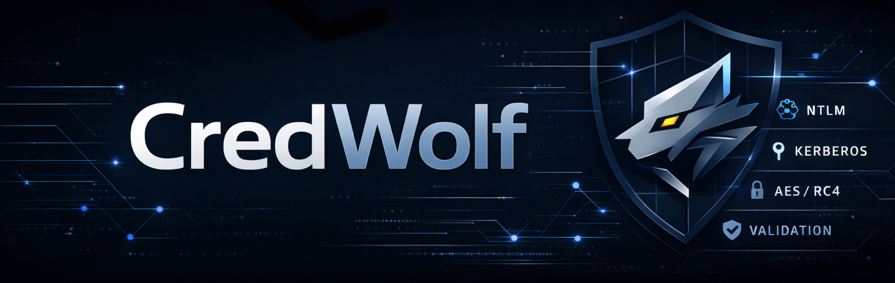

<p align="center">
  <a href="https://strongwind.dev/CredWolf/"></a>
</p>

<p align="center"><strong>Find out which AD credentials still work. Passwords, NT hashes, Kerberos keys, and tickets, over NTLM or Kerberos.</strong></p>

<p align="center">
  <a href="https://github.com/StrongWind1/CredWolf/actions/workflows/ci.yml"></a>
  <a href="https://pypi.org/project/credwolf/"></a>
  <a href="https://www.python.org/"></a>
  <a href="LICENSE"></a>
  <a href="https://strongwind.dev/CredWolf/"></a>
</p>

<p align="center">
  <a href="https://strongwind.dev/CredWolf/getting-started/installation/">Installation</a> &bull;
  <a href="https://strongwind.dev/CredWolf/getting-started/quick-start/">Quick start</a> &bull;
  <a href="https://strongwind.dev/CredWolf/usage/ntlm/">Usage</a> &bull;
  <a href="https://strongwind.dev/CredWolf/reference/cli/">CLI reference</a> &bull;
  <a href="https://strongwind.dev/CredWolf/">Documentation</a>
</p>

---

CredWolf tests username and secret combinations (passwords, NT hashes, Kerberos keys, or ticket files) against a domain controller and reports which credentials are valid. It also enumerates valid usernames over Kerberos without causing login attempts. Where most credential testing tools go on to enumerate shares, dump SAM, or run commands, CredWolf only validates: it does no post-authentication activity by design ([comparison](https://strongwind.dev/CredWolf/comparison/)).

## Example

Validate a recovered password against a domain controller over SMB:

```console
$ credwolf -d evil.corp ntlm --dc-ip 10.0.0.1 -u Administrator -p 'Password1!'
[+] evil.corp/Administrator:Password1!@password
```

## Features

- **NTLM and Kerberos**: validate credentials over SMB, LDAP, LDAPS, and Kerberos pre-authentication (UDP or TCP).
- **Every secret type**: passwords, NT hashes (bare or `LM:NT`), RC4, AES128, and AES256 keys, and ticket files (ccache or kirbi, auto-detected).
- **Username enumeration**: discover valid AD accounts over Kerberos without login failures or lockouts; ASREProastable accounts are flagged automatically.
- **Username case correction**: with Kerberos AES authentication the KDC returns the correct username casing in the salt, and CredWolf uses the corrected name in all output.
- **88+ credential permutations**: every meaningful combination of user source, secret source, encryption type, and transport, including paired `user:password`, `user:hash`, and `user:key` files.
- **Machine-parseable output**: one `domain/user:secret@type` line per valid credential, easy to grep or pipe.
- **Safety-first errors**: clock skew stops execution immediately, unknown or revoked principals are skipped per user, and account status is detected in detail.
- **Rate limiting**: `--delay`, `--jitter`, and `--max-lockouts` keep a run under lockout policies.

## Installation

Install from [PyPI](https://pypi.org/project/credwolf/):

```sh
uv tool install credwolf        # recommended
pip install credwolf             # or with pip
```

Or install from source:

```sh
uv tool install git+https://github.com/StrongWind1/CredWolf
```

The `cw` command is also installed as a shorthand for `credwolf`. Docker and the other install options are in the [installation guide](https://strongwind.dev/CredWolf/getting-started/installation/).

## Quick start

```console
# Validate a password over SMB
$ credwolf -d evil.corp ntlm --dc-ip 10.0.0.1 -u Administrator -p 'Password1!'
[+] evil.corp/Administrator:Password1!@password

# Validate an NT hash (pass-the-hash)
$ credwolf -d evil.corp ntlm --dc-ip 10.0.0.1 -u Administrator --hash 7facdc498ed1680c4fd1448319a8c04f
[+] evil.corp/Administrator:7facdc498ed1680c4fd1448319a8c04f@nt_hash

# Validate an AES256 key over Kerberos (pass-the-key)
$ credwolf -d evil.corp kerberos --kdc-ip 10.0.0.1 -u Administrator --aes256-key 9b12da6a4bdc263c1ac8f6302dc071e6e84321a263fa48784534b1ae43db2925 --transport tcp
[+] evil.corp/Administrator:9b12da6a4bdc263c1ac8f6302dc071e6e84321a263fa48784534b1ae43db2925@aes256_key

# Enumerate valid usernames (no login attempts, no lockout risk)
$ credwolf -d evil.corp userenum --kdc-ip 10.0.0.1 -U users.txt
[+] evil.corp/Administrator
[+] evil.corp/svc_backup — no_preauth (ASREProastable)
[*] Enumeration complete: 2/5 users found
```

See the full [usage guide](https://strongwind.dev/CredWolf/usage/ntlm/) and [CLI reference](https://strongwind.dev/CredWolf/reference/cli/) for all options.

## Supported protocols

| Protocol | Transport | Secret types |
| --- | --- | --- |
| **NTLM** | SMB (default), LDAP, LDAPS | Password, NT hash |
| **Kerberos** | UDP (default), TCP | Password, RC4 key, AES128 key, AES256 key, ticket (ccache/kirbi) |
| **Username enumeration** | UDP (default), TCP | None required |

## Development

```sh
git clone https://github.com/StrongWind1/CredWolf.git && cd CredWolf
uv sync                        # install dev dependencies
make check                     # lint, typecheck, tests, strict docs build
```

Conventional commit messages (`feat:`, `fix:`, `docs:`); run `make check` before every commit.

## Credits

Built on [Impacket](https://github.com/fortra/impacket). Inspired by [CrackMapExec](https://github.com/byt3bl33d3r/CrackMapExec), [Kerbrute](https://github.com/ropnop/kerbrute), [smartbrute](https://github.com/ShutdownRepo/smartbrute), and [SprayHound](https://github.com/Hackndo/sprayhound).

## Related tools

- [**KerbWolf**](https://github.com/StrongWind1/KerbWolf): Kerberos roasting and TGT attack toolkit for Active Directory
- [**NTDSWolf**](https://github.com/StrongWind1/NTDSWolf): Offline NTDS.dit parser and credential extractor for NT/LM hashes, Kerberos keys, LAPS, and gMSA
- [**PassWolf**](https://github.com/StrongWind1/PassWolf): Spec-compliant AD password change, reset, and policy read over SAMR, Netlogon, LSA, Kerberos, LDAP
- [**AD-SecretGen**](https://github.com/StrongWind1/AD-SecretGen): Derive every password-derived AD secret (NT/LM, Kerberos keys, WDigest) from a password
- [**ntcompress**](https://github.com/StrongWind1/ntcompress): Pure-Python ESE record compression and ntdll RtlCompressBuffer/RtlDecompressBuffer formats
- [**Kerberos**](https://github.com/StrongWind1/Kerberos): Protocol internals, security configuration, and attack techniques for Kerberos in Active Directory

All tools: [strongwind.dev](https://strongwind.dev)

## Disclaimer

CredWolf is for authorized security testing, research, and education. Use it only against systems and data you own or have written permission to test. You are responsible for how you use it.

## License

[Apache License 2.0](LICENSE)
